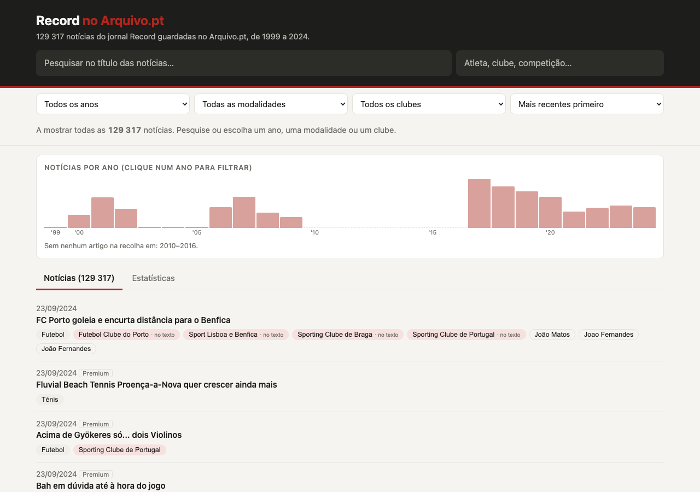

# Semantic Driven Harvester

Motor de colheita que recolhe notícias do jornal desportivo **Record** preservadas
no [Arquivo.pt](https://arquivo.pt), identifica os temas e as entidades
desportivas (clubes, atletas, treinadores, estádios e competições) e organiza
tudo num grafo RDF, ligado à Wikidata e descrito por uma ontologia em OWL.

Desenvolvido no âmbito da dissertação de Mestrado em Engenharia Informática
*Motor de colheita de informação orientado por ontologias – Caso de Estudo Sobre
a Informação Desportiva ao Longo do Tempo* (Universidade do Minho, 2026).



## Em números

- **200 101 notícias** do Record, de 1999 a 2024
- **8 904 entidades** distintas, identificadas pelo seu endereço na Wikidata
- **77 %** das notícias com pelo menos uma entidade identificada
- **12 milhões de triplos** RDF, consultáveis com SPARQL

## Experimentar o protótipo

Não é preciso instalar nada.

1. Abrir a [página de releases](https://github.com/JorgeTeixeira20/semantic-driven-harvester/releases)
   e descarregar `prototipo_completo.zip` da versão `v1.0-tese`.
2. Descomprimir e abrir `prototipo_completo/index.html` no navegador.

É possível pesquisar notícias pelo título, filtrar por ano, modalidade ou clube
e escolher uma entidade (por exemplo, "Sporting Clube de Braga") para ver as
notícias em que é mencionada.

## Gerar o protótipo a partir do grafo

A release inclui também `dados_completo.zip`, com o grafo RDF e as tabelas de
que o protótipo precisa. Com Python 3.11 ou superior:

```bash
git clone https://github.com/JorgeTeixeira20/semantic-driven-harvester.git
cd semantic-driven-harvester
python3 -m venv .venv
.venv/bin/pip install -e ".[sparql]"
unzip /caminho/para/dados_completo.zip   # na raiz do repositório
.venv/bin/python -m semantic_harvester.navigation_corpus --corpus completo \
  --vocabulario data/processed/caminho_b_vocabulario_hibrido_completo.csv \
  --fonte sparql --destino prototipo_verificacao
```

O protótipo fica em `output/prototipo_verificacao/` (cerca de 4 minutos) e é
idêntico ao da release. Os dados são obtidos através das consultas SPARQL em
[`queries/painel/`](queries/painel/).

Os textos e o HTML descarregados do Arquivo.pt não são publicados. Para refazer
todo o processo desde a recolha é preciso voltar a descarregá-los, o que demora
muitas horas.

## Como funciona

1. **Recolha:** pesquisa ano a ano na API do Arquivo.pt, em `record.pt` e
   `record.xl.pt`, e descarrega o texto e o HTML de cada captura.
2. **Seleção e limpeza:** identifica as páginas que são notícias e extrai o
   corpo, retirando menus, listas de outras notícias e outros elementos da página.
3. **Temas e entidades:** obtém a modalidade e o clube a partir do endereço e
   identifica as entidades no texto com um vocabulário construído a partir da
   Wikidata.
4. **Representação:** guarda artigos, capturas, textos, temas e entidades em
   RDF, segundo a ontologia em [`ontology/`](ontology/semantic_harvester.ttl).
5. **Exploração:** prepara os dados do protótipo através de consultas SPARQL.

## Organização do repositório

| Pasta | Conteúdo |
|---|---|
| [`src/semantic_harvester/`](src/semantic_harvester/) | Código do motor de colheita |
| [`ontology/`](ontology/) | Ontologia em OWL (Turtle) |
| [`queries/`](queries/) | Consultas SPARQL do protótipo e da validação |
| [`data/processed/`](data/processed/) | Vocabulários, amostras e anotações da avaliação |
| [`tests/`](tests/) | Testes automáticos (funcionam sem rede) |
| [`docs/`](docs/) | Documentação, experiências e figuras |

## Testes

```bash
.venv/bin/pip install -e .
.venv/bin/python -m unittest discover -s tests
```

## Mais informação

- [Guia de comandos](docs/guia_comandos.md): todos os comandos e parâmetros do motor.
- [Estado do projeto](docs/PROJECT_STATUS.md): o que está implementado e as limitações.
- [Experiências](docs/experiments.md): registo das experiências e das decisões tomadas.

## Autor

Jorge Teixeira, com orientação de José Carlos Ramalho e José João Almeida.
